<div dir="rtl" align="right">

# 📦 ניהול משלוחים

מערכת ניהול משלוחים בעברית למשרד ולשליח: יצירת משלוחים, מעקב סטטוסים וזמנים, הודעות אוטומטיות ללקוחות בוואטסאפ, כספים ותשלומים לשליח, דוחות, הדפסת מדבקות עם ברקוד, דף איתור חבילה ללקוחות, והתקנה כאפליקציה בטלפון.

האתר הוא קובץ HTML אחד (`index.html`) שרץ בדפדפן, עם **Firebase** להתחברות ולמסד הנתונים. אין שרת משלו.

> כל צילומי המסך במסמך זה הם עם נתוני דוגמה בדויים.

## תוכן עניינים

1. [תפקידים והרשאות](#תפקידים-והרשאות)
2. [מחזור החיים של משלוח](#מחזור-החיים-של-משלוח)
3. [תצוגת המשרד](#תצוגת-המשרד)
4. [תצוגת השליח](#תצוגת-השליח)
5. [פיצ'רים](#פיצרים)
6. [ארכיטקטורה ומבנה נתונים](#ארכיטקטורה-ומבנה-נתונים)
7. [הגדרה והתקנה](#הגדרה-והתקנה)
8. [גרסאות וחזרה אחורה](#גרסאות-וחזרה-אחורה)
9. [אבטחה ופרטיות](#אבטחה-ופרטיות)
10. [מגבלות ידועות](#מגבלות-ידועות)

---

## תפקידים והרשאות

כל משתמש מתחבר עם אימייל וסיסמה. התפקיד נקבע לפי כתובת האימייל (בקוד ובחוקי האבטחה של Firestore).

| יכולת | אדמין | משרד | שליח |
|---|:-:|:-:|:-:|
| יצירה, עריכה ומחיקה של משלוחים | ✅ | ✅ | ❌ |
| שינוי מחיר ופרטי משלוח אחרי היצירה | ✅ | ✅ | ❌ |
| ביטול משלוח | ✅ | ✅ | ❌ |
| עדכון סטטוס, כשל במסירה, הערת שליח, צילום מסירה | ✅ | ✅ | ✅ |
| חיפוש, מוני קטגוריות, דוחות | ✅ | ✅ | ✅ (בלי מחירים) |
| הדפסת מדבקות | ✅ | ✅ | ❌ |
| עריכת נוסח הודעות ללקוחות | ✅ | ✅ | ❌ |
| מחירון, כספים ותשלומים לשליח | ✅ | ❌ | ❌ |
| מרכז התראות על משלוחים חדשים | – | – | ✅ |

ההרשאות נאכפות גם בממשק וגם בחוקי האבטחה של Firestore (`firestore.rules`), כך שאי אפשר לעקוף אותן מהדפדפן.

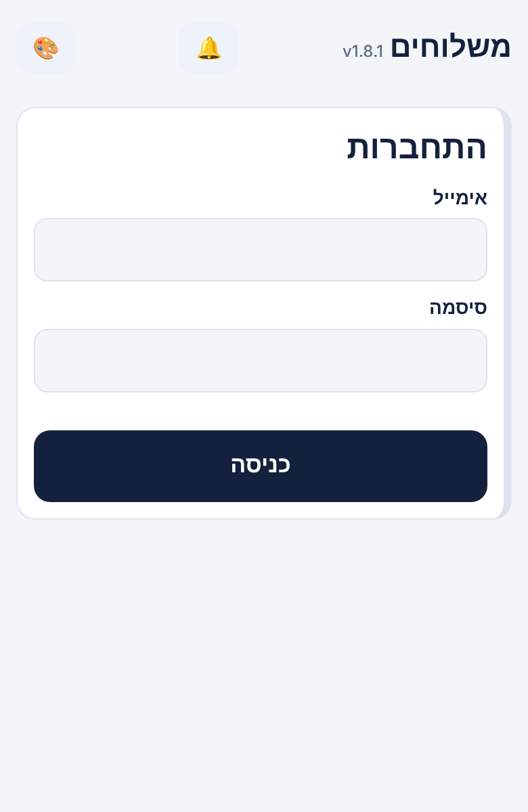

---

## מחזור החיים של משלוח

### סוגי משלוח

| סוג | הערות |
|---|---|
| רגיל | משלוח חד-כיווני |
| כפול | הלוך וחזור: אחרי המסירה השליח חוזר למשרד |
| איסוף | **חזור בלבד**: השליח אוסף מהלקוח וחוזר למשרד |
| מהיר | משלוח חד-כיווני |
| קרטון | משלוח חד-כיווני |
| גוביינא | הלוך וחזור, עם שדה **סכום לגבייה** שמוצג לשליח |

### סטטוסים

```
חדש  →  נאסף  →  בדרך ללקוח  →  בוצע  →  (בדרך חזרה למשרד  →  חזר למשרד)
```

- משלוח **איסוף** מדלג על "נאסף" ומקבל "נאסף מהלקוח" במקום "בוצע".
- שלבי החזרה קיימים רק בסוגים הלוך וחזור: כפול, איסוף וגוביינא.
- **כשל במסירה:** נשמר עם סיבה (אין מענה, כתובת שגויה, נדחה על ידי הלקוח למועד אחר, אחר עם פירוט). המשלוח נשאר פעיל, והשליח יכול לבצע ניסיון חוזר.
- **בוטל:** המשרד מבטל משלוח, בלי השפעה על הכספים.

### טיימר

לכל משלוח טיימר של **5 ימי עסקים** (ראשון עד חמישי) מרגע היצירה. הצבעים: ירוק, כתום ביום האחרון, ואדום באיחור. הטיימר נעצר כשהמשלוח נמסר, וביטול עוצר אותו גם כן.

### היסטוריה

כל שינוי נרשם עם תאריך, שעה והמשתמש (משרד או שליח): יצירה, כל שינוי סטטוס, עדכון פרטים או מחיר, תמונת מסירה והערות. בכל כרטיס אפשר לפתוח את ההיסטוריה המלאה.

---

## תצוגת המשרד

### תצוגת שורות מתרחבות

כל משלוח הוא שורה קומפקטית: מספר, שם, כתובת, סוג, סכום גוביינא, סטטוס וטיימר. לחיצה על שורה פותחת את כל הפרטים והפעולות. אפשר לסמן שורות (להדפסת מדבקות) ולעבור לתצוגת כרטיסים.

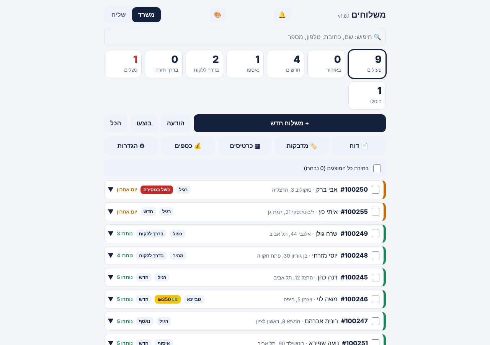
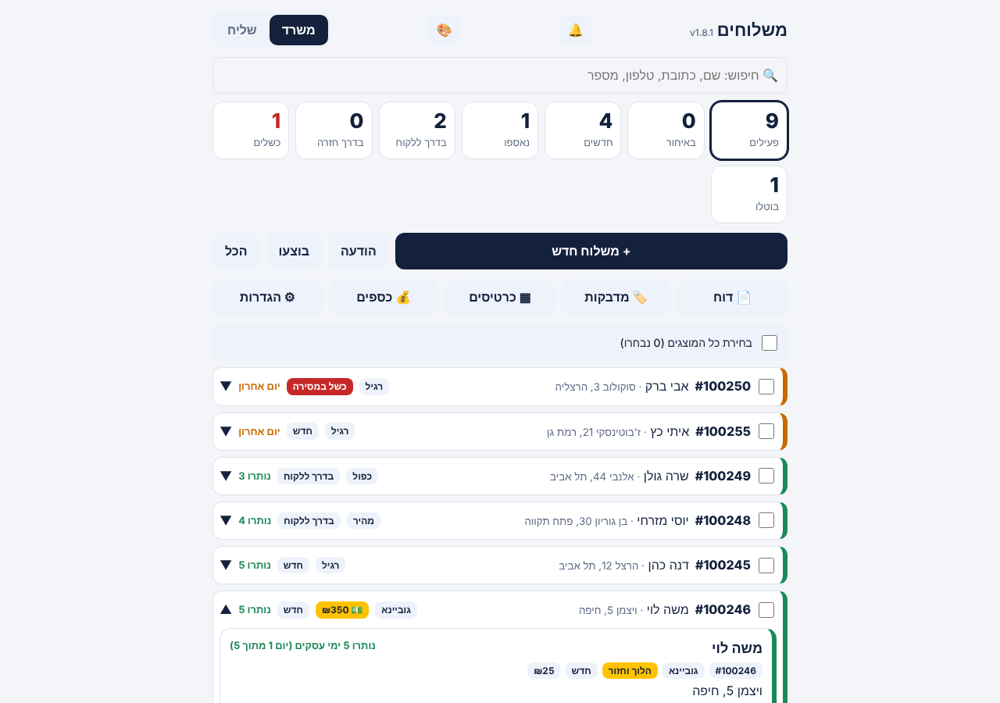

<table dir="rtl"><tr>
<td>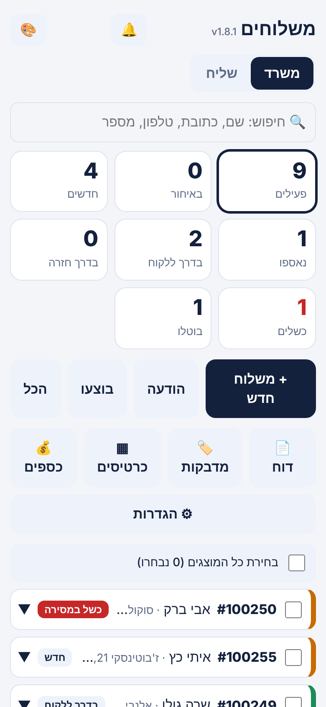</td>
<td>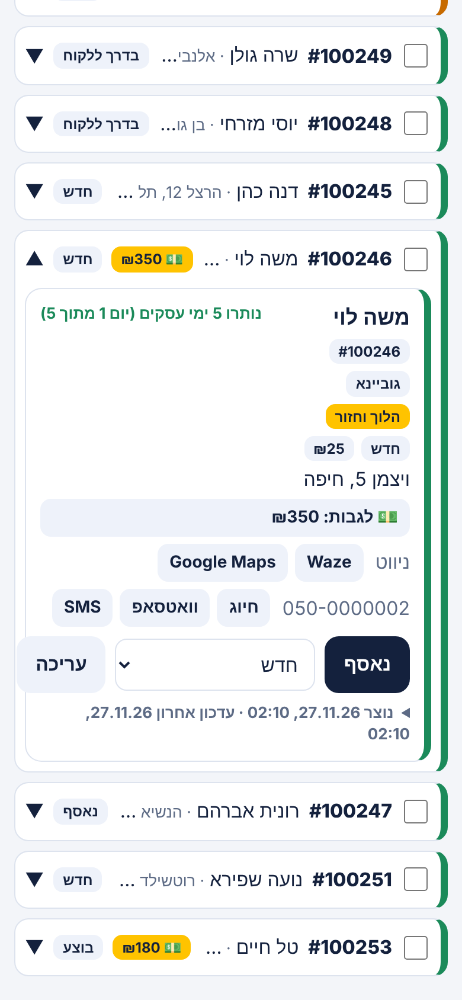</td>
</tr></table>

### מוני קטגוריות

דשבורד: פעילים, באיחור, חדשים, נאספו, בדרך ללקוח, בדרך חזרה, כשלים ובוטלו. לחיצה על מונה מסננת את הרשימה. כפתורי "בוצעו" ו"הכל" מציגים משלוחים שהסתיימו או את כולם.

### יצירה ועריכה של משלוח

שדות: שם, כתובת, טלפון, מספר חבילה, סוג, מחיר, סכום לגבייה (בגוביינא בלבד) והערות. המחיר מתמלא אוטומטית לפי המחירון ואפשר לשנות אותו אחרי היצירה.

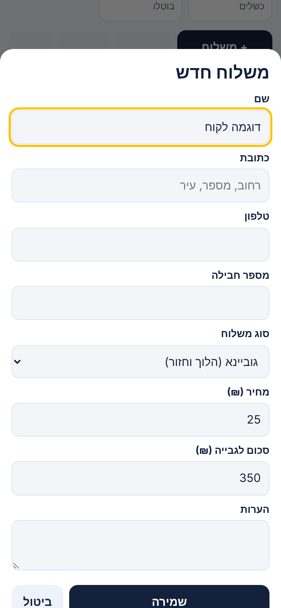

- **כתובת:** קישורי ניווט ב-Waze וב-Google Maps. בהגדרת מפתח Google (ראו [הגדרה](#חיפוש-כתובת-בגוגל-לא-חובה)) מתווסף חיפוש כתובת עם הצעות.
- **טלפון:** כפתורי חיוג, וואטסאפ ו-SMS, עם הודעה מוכנה לפי התבנית.

### חיפוש

שורת חיפוש מעל הכל, בכל שדה: שם, כתובת, טלפון (גם בפורמט בינלאומי), מספר חבילה, הערות, סכום, סוג, סטטוס וסיבת כשל. כמה מילים ביחד מצמצמות את התוצאות, והחיפוש כולל משלוחים שהסתיימו.

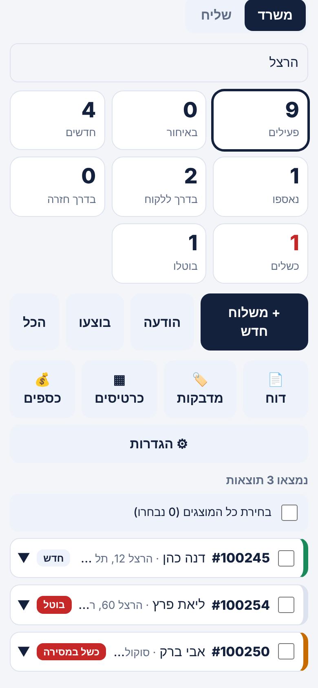

---

## תצוגת השליח

השליח רואה אותם דברים כמו המשרד, בלי מחירים ובלי יכולת עריכה: מוני קטגוריות, חיפוש, דוחות, וכרטיסים מקובצים לפי שלב (חדשים לאיסוף, נאספו, בדרך ללקוח, כשל במסירה, בדרך חזרה). בכל כרטיס כפתור גדול לשלב הבא, כפתור כשל, הערת שליח, ושדה לצילום מסירה (מצלמה או גלריה, לא חובה).

<table dir="rtl"><tr>
<td>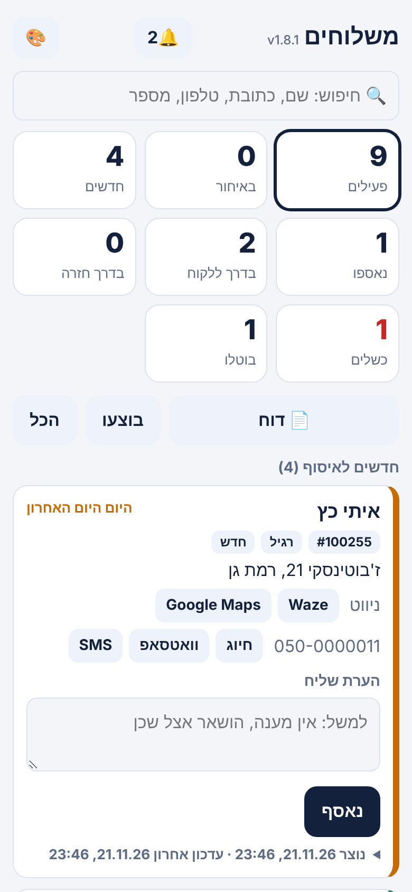</td>
<td>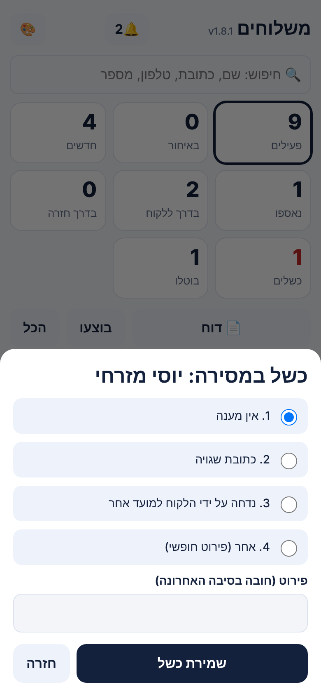</td>
<td>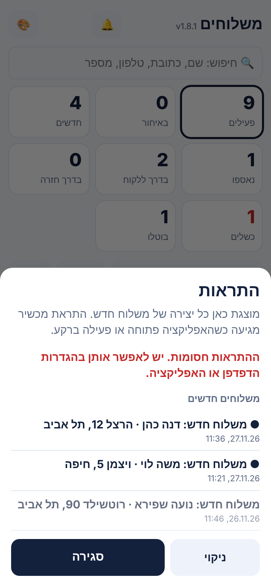</td>
</tr></table>

---

## פיצ'רים

### 💬 הודעות וואטסאפ ללקוחות

בשינוי סטטוס בלחיצה על הכפתור הגדול נפתח לשליח חלון עם הודעה מוכנה ולחצן "שליחה בוואטסאפ" (הוואטסאפ דורש לחיצה, אין שליחה אוטומטית לגמרי):

| אירוע | הודעה |
|---|---|
| נפתחה בקשת איסוף | כפתור "📲 הודעת איסוף" בכרטיס של משלוח איסוף חדש |
| נאסף | ההזמנה התקבלה במחסנים ותצא להפצה, עם קישור למעקב |
| בדרך ללקוח | החבילה תגיע היום ל{כתובת}, הוראות תיקון כתובת ומעקב |
| נמסר | המשלוח נמסר הרגע |

אפשר לערוך את כל ההודעות. המשתנים: `{שם}` `{מספר}` `{כתובת}` `{סכום}` `{קישור}`. הקישור הוא קישור אישי לדף האיתור, שממלא לבד את מספר החבילה והטלפון של הלקוח.

<table dir="rtl"><tr>
<td>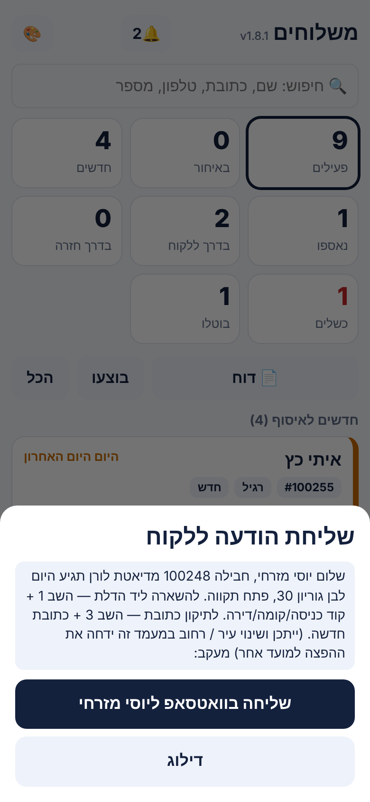</td>
<td>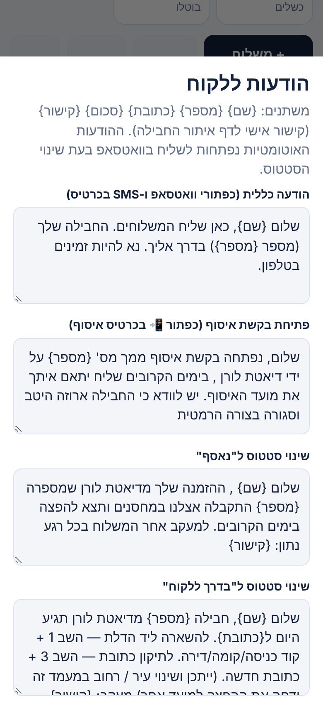</td>
</tr></table>

### 💰 מחירון, כספים ותשלומים (אדמין)

- **מחירון:** מחיר לשליח לכל סוג משלוח. משלוח שנוצר שומר את המחיר שלו, ושינוי מחירון משפיע רק על משלוחים חדשים.
- **כספים:** סכום שנצבר (משלוחים שנמסרו), כמה שולם לשליח, וכמה נותר לתשלום.
- **תשלומים:** הזנת תשלום עם הערה. הוא מוריד מהסכום שנותר, ואפשר למחוק תשלום.

<table dir="rtl"><tr>
<td>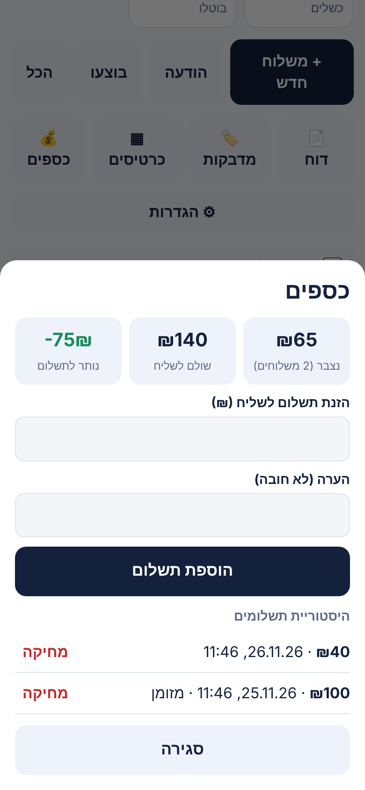</td>
<td>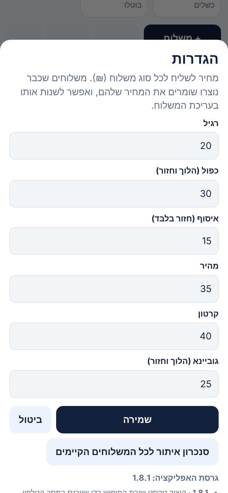</td>
</tr></table>

### 📄 דוחות

דוח פירוט משלוחים עם סינון לפי טווח תאריכי יצירה, סטטוס וסוג, ובחירת עמודות. שלוש דרכי הוצאה: תצוגה להדפסה (גם שמירה ל-PDF), הורדת CSV שנפתח באקסל בעברית תקינה, והעתקה להדבקה ישירה בגיליון. בדוח של השליח אין מחירים.

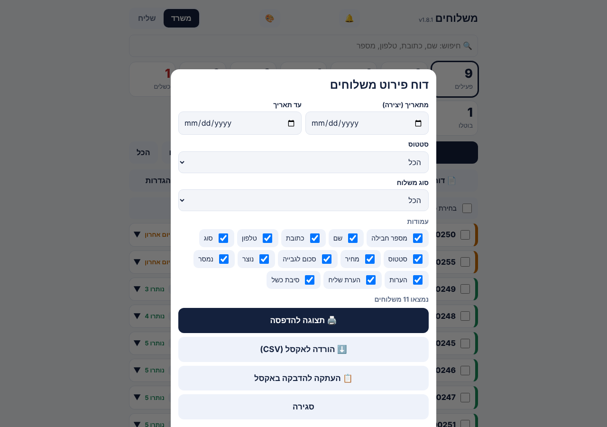
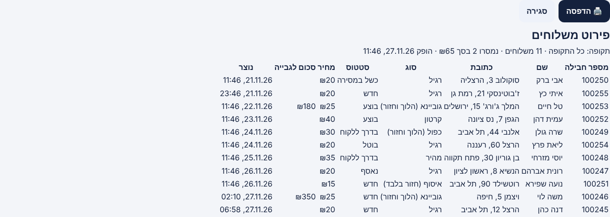

### 🏷️ מדבקות עם ברקוד

הדפסת מדבקות **70×105 מ"מ, 8 בדף A4**, עם ברקוד Code128 של מספר החבילה.

- **מה להדפיס:** כל החדשים שלא נאספו, המשלוחים שסומנו בשורות, או הרשימה המוצגת.
- **מיקומים פנויים:** מסמנים אילו מקומות בדף עוד פנויים (למשל דף שכבר נוצל חלקית). מדבקות שנותרו עוברות לדף חדש.
- **עדכון מיקומים:** אחרי ההדפסה כפתור "✔ עדכן מיקומים שנוצלו" שומר מה נותר בדף.
- **כיול:** מרווח עליון ושמאלי במ"מ, לתיקון הסטה של המדפסת.
- בגוביינא מופיע "לגבות ₪X" בולט. מספר חבילה עם אותיות בעברית יודפס כטקסט בלי ברקוד.

כדי להדפיס נכון בדפדפן: נייר A4, שוליים ללא, וסקייל 100%. מומלץ הדפסת ניסיון על נייר רגיל והנחה מעל דף המדבקות מול האור.

<table dir="rtl"><tr>
<td>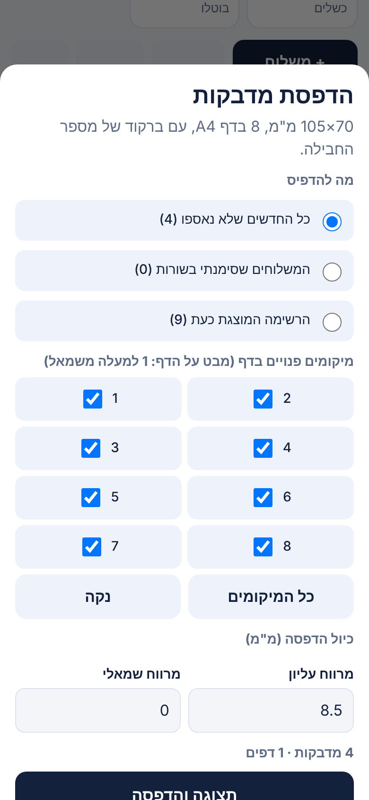</td>
<td>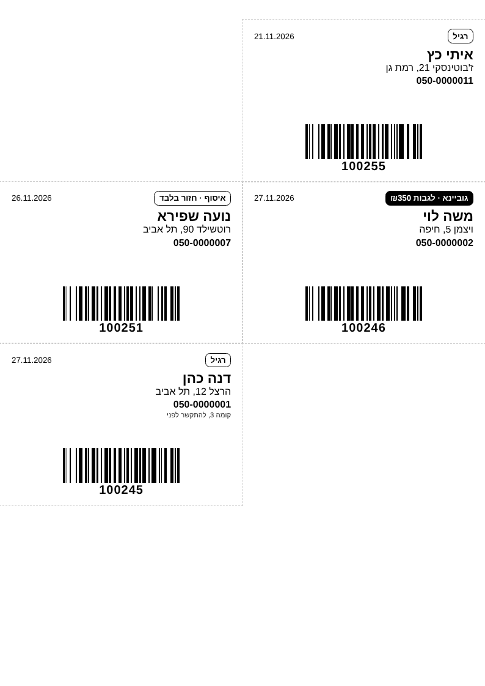</td>
</tr></table>

### 🔎 דף איתור חבילה ללקוח

הלקוח נכנס ל-`track.html`, מזין את מספר החבילה ואת הטלפון שלו, ורואה את הסטטוס ואת שעות העדכון. הקישור שנשלח בהודעות ממלא את הפרטים אוטומטית.

- הלקוח לא רואה כתובת, שם, מחיר או תמונה, אלא רק מספר חבילה, שלב וזמנים.
- לכשל או ביטול מוצגת הודעה מתאימה בלי הסיבה הפנימית.

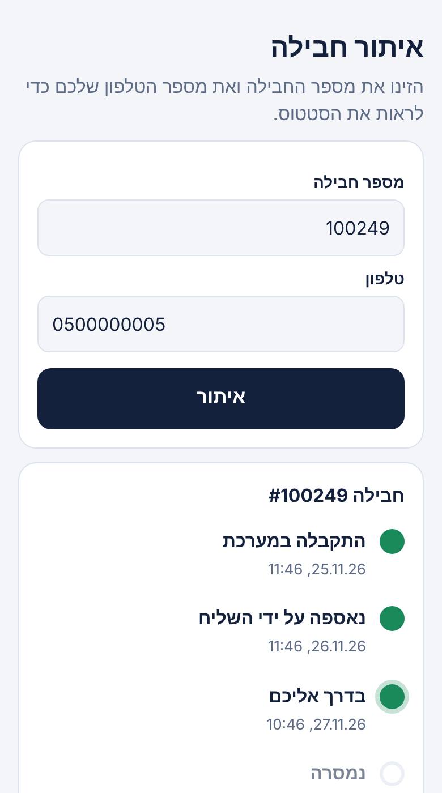

### 🔔 התראות לשליח

מרכז התראות (🔔) מציג כל משלוח חדש, כולל כאלה שנוצרו כשהאפליקציה הייתה סגורה. אפשר להפעיל גם התראת מכשיר, והיא מגיעה כשהאפליקציה פתוחה או פעילה ברקע.

### 📲 התקנה כאפליקציה

באנדרואיד מופיע כפתור "📲 התקנה" בראש העמוד. באייפון הכפתור מציג הוראות "הוסף למסך הבית". האפליקציה נפתחת במסך מלא עם אייקון משלה.

### 🎨 מראה אישי

כל משתמש בוחר מצב תצוגה (אוטומטי, בהיר או כהה) ואחת מחמש פלטות צבעים. הבחירה נשמרת במכשיר.

<table dir="rtl"><tr>
<td>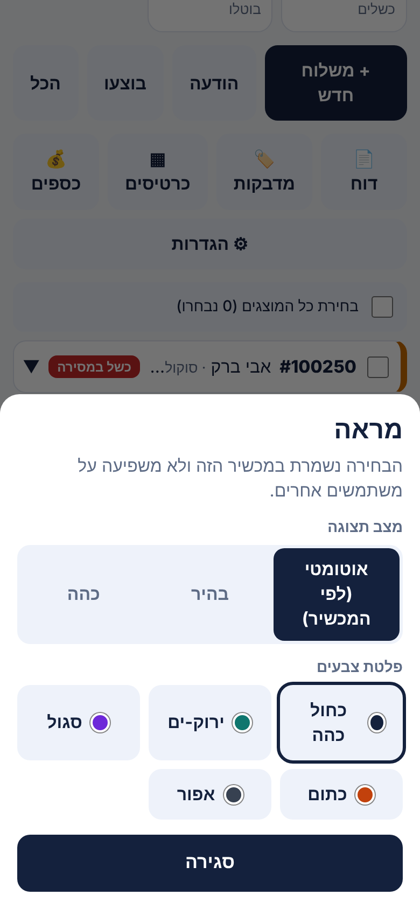</td>
<td>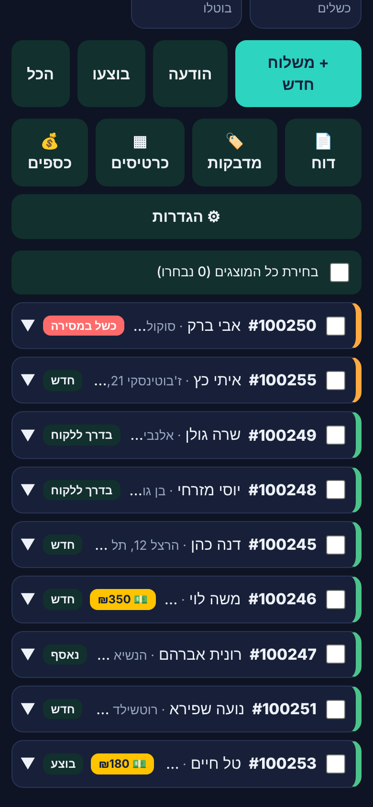</td>
</tr></table>

---

## ארכיטקטורה ומבנה נתונים

**קבצי הפרויקט**

| קובץ | תפקיד |
|---|---|
| `index.html` | כל האפליקציה (HTML, CSS ו-JavaScript בקובץ אחד) |
| `track.html` | דף האיתור הציבורי ללקוחות |
| `firestore.rules` | חוקי האבטחה, להדבקה ב-Firebase |
| `manifest.webmanifest`, `sw.js`, `icon-*.png` | התקנה כאפליקציה והתראות |
| `favicon.*`, `apple-touch-icon.png` | אייקון הלשונית |
| `docs/screenshots/` | צילומי המסך של המסמך הזה |

**טכנולוגיות:** JavaScript רגיל ללא תלויות, Firebase Authentication (אימייל וסיסמה), Cloud Firestore, ו-Service Worker. האירוח הוא סטטי (Cloudflare או GitHub Pages).

**אוספים ב-Firestore**

| אוסף | תוכן | מי יכול |
|---|---|---|
| `parcels` | המשלוחים: פרטים, סטטוס, מחיר, סכום לגבייה, תמונה (דחוסה), הערות והיסטוריה | משרד: הכל. שליח: קריאה ועדכון שדות מוגבלים |
| `settings/msg` | נוסחי ההודעות ללקוחות | קריאה למשרד ולשליח, כתיבה למשרד |
| `settings/prices` | המחירון | קריאה למשרד, כתיבה לאדמין |
| `payments` | תשלומים לשליח | אדמין בלבד |
| `track` | מסמך ציבורי מינימלי לדף האיתור (מזהה: גיבוב SHA-256 של מספר חבילה וטלפון) | קריאה של מסמך בודד לכולם, ללא רשימה. כתיבה למשרד ולשליח |

השליח יכול לעדכן רק את השדות: `status`, `doneAt`, `photo`, `courierNote`, `log`, `failReason`.

---

## הגדרה והתקנה

### 1. Firebase

1. ב-[Firebase Console](https://console.firebase.google.com) פתחו פרויקט חדש.
2. **Authentication:** הפעילו Email/Password והוסיפו משתמשים (אדמין, משרד, שליח).
3. **Firestore Database:** צרו מסד נתונים במצב production.
4. **Rules:** הדביקו את `firestore.rules` אחרי שהחלפתם את כתובות האימייל בכתובות שלכם (באותיות קטנות), ולחצו Publish.
5. **Web app:** הוסיפו אפליקציית Web והעתיקו את `firebaseConfig`.
6. **Authorized domains:** ב-Authentication ← Settings הוסיפו את הדומיין של האתר.

### 2. הגדרות בקוד

בראש הסקריפט ב-`index.html`:

```js
var FIREBASE_CONFIG = { apiKey: "...", authDomain: "...", projectId: "...", appId: "..." };
var ADMIN_EMAILS  = ["admin@example.com"];   // אדמין: הכל כולל כספים
var OFFICE_EMAILS = ["office@example.com"];  // משרד
// שליח: כל משתמש אחר שמורשה ב-firestore.rules
```

הכתובות חייבות להיות זהות לאלה שב-`firestore.rules`. בנוסף עדכנו בתוך `index.html` את `TRACK_URL` לכתובת דף האיתור, והאפליקציה תשתמש בה בהודעות.

### 3. אירוח

העלו את הקבצים לאחסון סטטי. Cloudflare Workers או Pages מחוברים למאגר מעדכנים את האתר אוטומטית בכל push. ב-GitHub Pages: Settings ← Pages ← `main` ← root.

### 4. התראות ותקופת עסקים

- **ימי עסקים:** `WORKDAYS` (ברירת מחדל ראשון עד חמישי) ו-`LIMIT` (5 ימים) בקוד.
- **דף איתור למשלוחים קיימים:** אחרי שדרוג, האדמין לוחץ ⚙ הגדרות ← "סנכרון איתור לכל המשלוחים הקיימים".

### חיפוש כתובת בגוגל (לא חובה)

1. ב-Google Cloud Console הפעילו **Places API (New)** (נדרש חשבון חיוב).
2. צרו API key, והגבילו אותו: Websites לדומיין שלכם, ו-API restrictions ל-Places API (New).
3. הדביקו אותו במשתנה `GOOGLE_KEY` בקוד.

---

## גרסאות וחזרה אחורה

מספר הגרסה מוצג ליד הכותרת ובהגדרות (עם רשימת שינויים). כל גרסה מסומנת ב-git בתגית `vX.Y.Z`.

| גרסה | שינוי עיקרי |
|---|---|
| 1.8.1 | קיצור טקסט שורת החיפוש |
| 1.8.0 | שורות מתרחבות, מדבקות 70×105 עם ברקוד |
| 1.7.0 | התקנה כאפליקציה, התראות, מוני קטגוריות וחיפוש לשליח |
| 1.6.0 | גוביינא וסכום לגבייה |
| 1.5.2 | אייקון לשונית |
| 1.5.1 | קישור איתור בכתובת החדשה |
| 1.5.0 | בחירת מראה ופלטת צבעים |
| 1.4.0 | דוחות להדפסה ולאקסל |
| 1.3.0 | כשל במסירה וביטול, הודעות וואטסאפ אוטומטיות |
| 1.2.0 | חיפוש, דף איתור ללקוחות, תפקידים |
| 1.1.0 | מחירון, כספים, איסוף חזור בלבד |
| 1.0.0 | גרסה ראשונה |

**חזרה לגרסה קודמת:**

```bash
git checkout v1.5.2 -- index.html track.html
git commit -m "חזרה לגרסה 1.5.2"
git push
```

אפשר גם לפתוח את התגית ב-GitHub (Tags), להעתיק את הקובץ ולהחליף אותו. שימו לב: חוקי Firestore מתעדכנים ידנית ב-Firebase, ולכן חזרה לגרסה ישנה לא מחזירה אותם.

---

## אבטחה ופרטיות

- ההרשאות נאכפות בחוקי Firestore לפי כתובת האימייל, ולא רק בממשק.
- ערכי `firebaseConfig` אינם סודיים. ההגנה על הנתונים באה מחוקי האבטחה.
- מפתח Google חייב להיות מוגבל לדומיין ול-Places API בלבד.
- **דף האיתור:** המסמך הציבורי מכיל רק מספר חבילה, שלב וזמנים. הגישה אליו רק בשליפה של מסמך בודד לפי גיבוב של מספר החבילה והטלפון, ואין אפשרות לרשום או לסרוק מסמכים.
- ה-`robots` מוגדר `noindex`, כדי שהאתר לא יופיע בחיפוש.
- אסור לשמור טוקנים או סיסמאות בקוד או במאגר. טוקן גיטהאב שנחשף יש לבטל.

---

## מגבלות ידועות

- **התראות כשהאפליקציה סגורה לגמרי** דורשות שרת Push (Firebase Cloud Messaging עם פונקציית ענן, בתוכנית Blaze). כיום ההתראות עובדות כשהאפליקציה פתוחה או פעילה ברקע.
- בחירת המראה, מרכז ההתראות והגדרות המדבקות נשמרים **במכשיר** ולא בחשבון.
- ההודעות בוואטסאפ ובמסרונים נפתחות מוכנות לשליחה, ודורשות לחיצה על שליחה.
- הורדת אקסל היא קובץ CSV ולא `.xlsx`.
- משלוחים עם אותו מספר חבילה ואותו טלפון חולקים מסמך איתור אחד, והלקוח יראה את האחרון.
- באייפון התראות ותמיכה מלאה באפליקציה דורשות התקנה למסך הבית (iOS 16.4 ומעלה).

</div>
